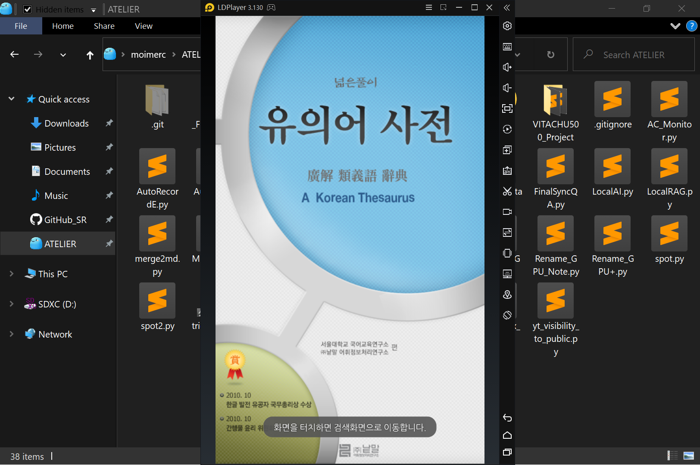
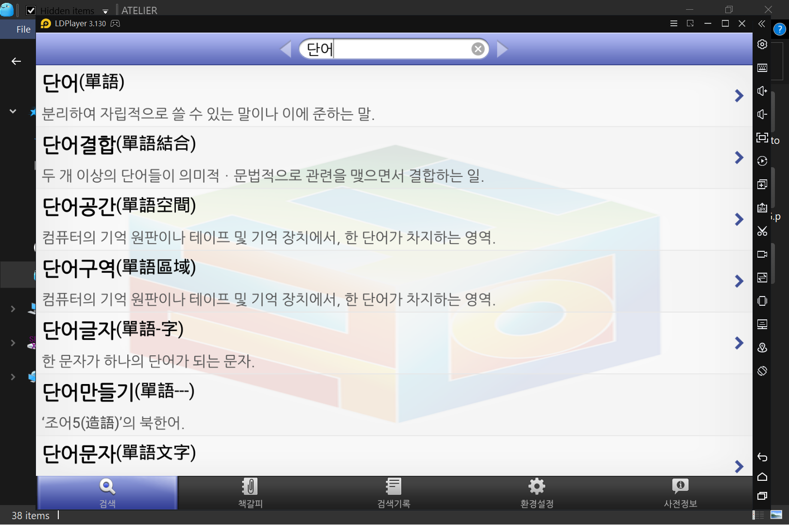
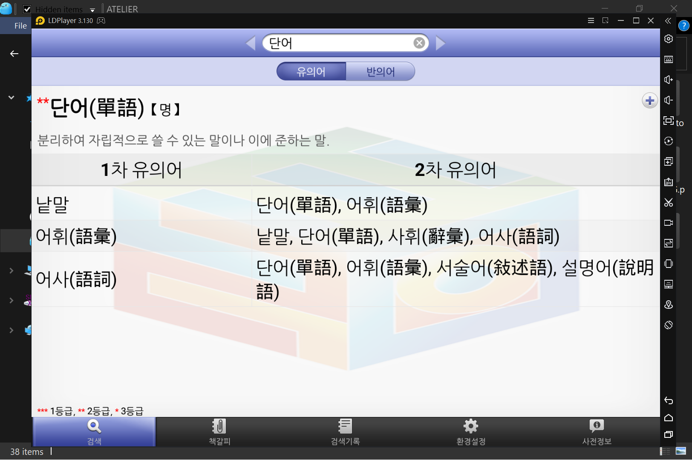
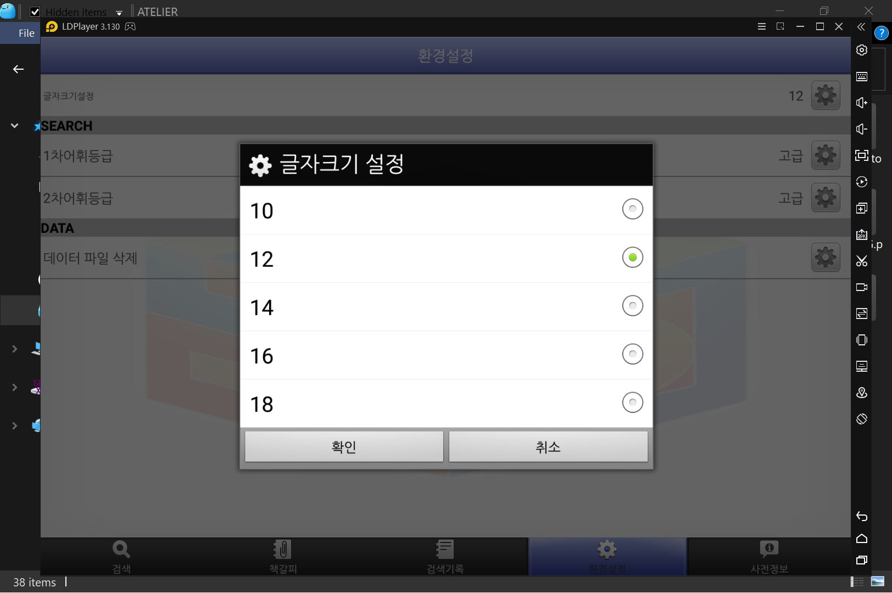
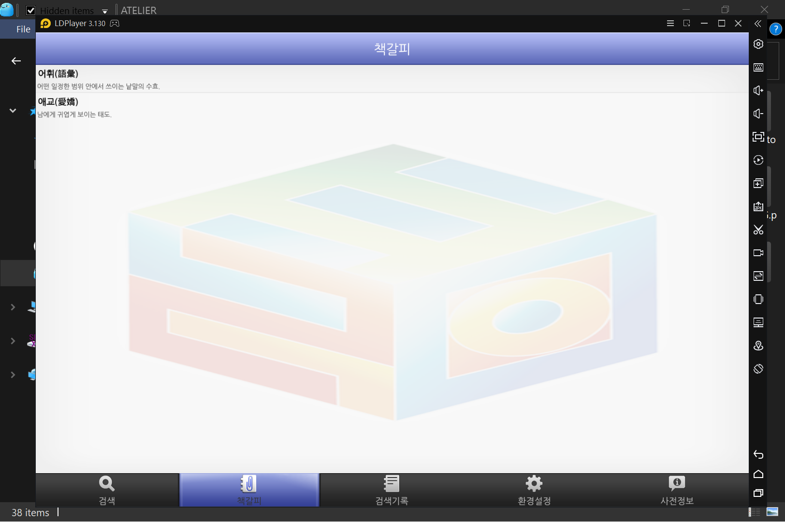

# Android APK Reverse Engineering: Legacy Dictionary x86 Porting Write-up

## Overview
A reverse engineering and binary porting case study for an abandoned 2014 Korean Synonym Dictionary Android application (`com.wordnet.dic.synonym`, originally targeting Android 2.2 Froyo).

Because the application relies on legacy 32-bit ARM native libraries, a customized SQLCipher implementation, and defunct Google Play Licensing (LVL) checks, it immediately crashes on modern x86 Android emulators (such as LDPlayer) and current Android OS releases. This repository documents the complete workflow—from diagnosing binary translation crashes and bypassing a static decoy password trap via runtime hooking, to transplanting x86 native libraries and patching Dalvik bytecode (`Smali`) and XML layouts.

> **Disclaimer**: This repository is strictly for educational, archival, and interoperability research purposes (preserving personally purchased abandonware). **No proprietary APK binaries, dictionary database files (`.db`), or full decompiled application sources are hosted in this repository.** Only analytical scripts, targeted patch files, and sanitized diagnostic logs are provided.

---

## Technical Process & File Mapping

### Phase 1: Root Cause Analysis (`libhoudini.so` SIGSEGV)
* **Symptom**: When launched on an x86 emulator (LDPlayer 3.0, Android 5.1.1), the app displays a black splash screen. If the external dictionary database (`/sdcard/wordnet/.dicPyojaeEnc20140812.db`, ~43.4 MB) is present, touching the screen to enter the search view triggers an immediate `Fatal signal 11 (SIGSEGV)`.
* **Diagnosis**: 
  * Initial ADB inspection scripts (`scripts/archive/check_ldplayer_abi.py` and `scripts/archive/diag_ldplayer.py`) were refined into `scripts/diag_ldplayer_v3.py` to query device ABI properties, inspect `/proc/<pid>/maps`, and capture filtered logcat output without dropping the ADB daemon connection.
  * The captured crash log (`docs/evidence/crash_ldplayer_houdini.txt`) proved that the fault occurs inside `/system/lib/libhoudini.so` (Intel's ARM-to-x86 binary translation layer) immediately after loading the app's bundled ARM native libraries (`libstlport_shared.so`, `libsqlcipher_android.so`, and `libdatabase_sqlcipher.so`).

### Phase 2: Static Analysis & The Decoy Key Trap
* **Source Reconnaissance**: Using `scripts/search_sources.py` on the decompiled APK, database initialization was traced to `com.wordnet.dic.synonym.data.DatabaseHelper`. A 68-character plaintext string (`DBPW = "s3KkssFmsdksemfhdl@emr7oqkfwkd!lek!gozldgksmst9oRlsm5sskrke0lwufk1"`) was hardcoded and passed directly to `SQLiteDatabase.openOrCreateDatabase()` (initial notes recorded in `docs/Wordnet_Key.txt`).
* **Decoy Verification**:
  * An initial Python decryption attempt (`scripts/archive/decrypt_db.py`) using `pysqlcipher3` and SQLCipher 2.x PRAGMAs failed.
  * To rule out parameter mismatches, `scripts/archive/brute_sqlcipher.py` automated `sqlcipher.exe` across **991 combinations** of `cipher_compatibility` (1–4), `cipher_page_size` (512–16384), `kdf_iter`, and HMAC/KDF algorithms. All 991 attempts failed (`docs/evidence/brute_log.txt`).
* **Native Binary Inspection**: Using `scripts/archive/extract_strings.py` and the filtered `scripts/extract_sqlcipher_strings.py` alongside `scripts/compareSymbol.py`, inspection of `libdatabase_sqlcipher.so` revealed custom C++ JNI symbols (such as `_ZN9sqlcipher10setICURoot...` and `SQLCIPHER_ICU_PREFIX`) not present in standard builds. The 68-character string in Java was merely a decoy input transformed internally by the custom native library before calling `sqlite3_key`.

### Phase 3: Dynamic Analysis (Heap Memory Dump vs. Frida Hooking)
* **Attempt 1 — Process Memory Dump (Android 4.2.2, Xperia A)**:
  * On a rooted Jelly Bean device where modern Frida servers could not execute, `scripts/xperia_dump.py` was used to locate readable/writable heap segments (`rw-p` in `/proc/<pid>/maps`) and dump ~276.6 MB of process memory while the dictionary was active.
  * `scripts/archive/analyze_dump.py` parsed the SQLite header at offset `0xf488420` (confirming `page_size = 1024` and `44,480` total pages) and scanned the dump for B-tree page signatures, logging candidate offsets to `docs/evidence/table_leaf_offsets.txt` and `docs/evidence/index_leaf_offsets.txt`.
  * However, both full database reassembly (`scripts/archive/extract_from_dump.py`) and raw B-tree record carving (`scripts/archive/extract_records.py`) proved incomplete because decrypted pages in the SQLite page cache were non-contiguous in memory.
* **Attempt 2 — Runtime Native Hooking (Android 6.0, Xperia Z3 Tablet Compact)**:
  * After unlocking the bootloader and rooting an Android 6.0 tablet, Frida was deployed.
  * **`scripts/hook_key.py`**: Hooked `dlopen` / `android_dlopen_ext` to wait for `libdatabase_sqlcipher.so`, then attached an interceptor to `sqlite3_key`. Upon app launch, it captured the exact 14-byte runtime key passed to the SQLite codec: **`papa@leave3463`**.
  * **`scripts/hook_export.py`**: Captured the active `sqlite3*` database handle pointer in `sqlite3_key`'s `onEnter` callback and invoked `sqlite3_exec` in `onLeave` to run `ATTACH DATABASE ... SELECT sqlcipher_export('plaintext');`, forcing the app's own native engine to dump a complete plaintext database (`plaintext_final.db`).
  * **`scripts/recon_all_v2.py`** (evolved from `scripts/archive/recon_all.py`): Extracted `synBookmark.db` via `adb exec-out`, enumerated all loaded native modules (`docs/evidence/modules_20260917_052446.txt`), logged Java-layer `SQLiteDatabase` calls (`docs/evidence/keys_20260917_052446.txt`), and hooked Java exceptions to diagnose subsequent UI crashes.
  * **`scripts/brute_sqlcipher_v2.py`**: Tested the captured key `papa@leave3463` across 1,500 combinations (15 key encodings × 100 PRAGMA sets) on PC. It succeeded on attempt **3/1500** (`plain-utf8-passphrase` + `PRAGMA cipher_compatibility = 3;`), generating `plaintext_dic.db` (`docs/evidence/brute_log_v2.txt`).

### Phase 4: x86 Native Library Porting & ABI Enforcement
Rather than stripping SQLCipher and rewriting the Java data layer for plaintext SQLite, we opted to transplant official x86 SQLCipher native libraries into the APK and patch the key in Smali.
* **AAR Scanning & Symbol Matching**:
  * `scripts/scan_aars.py` scanned 14 historical `.aar` packages of `net.zetetic:android-database-sqlcipher` (`3.3.1` through `3.5.9`). As logged in `docs/evidence/aar_scan_result.txt`, versions `3.3.1` through `3.4.0` were the last to use the exact 3-library structure (`libsqlcipher_android.so`, `libdatabase_sqlcipher.so`, `libstlport_shared.so`) before version `3.5.0` merged them into a single `libsqlcipher.so`.
  * `scripts/compareSymbol.py` compared C++ mangled JNI symbols between the original ARM `libdatabase_sqlcipher.so` and the x86 binary from the AAR, confirming that all 60 standard JNI symbols matched.
* **Extraction & ABI Priority Fix**:
  * `scripts/extract_aar.py` extracted the `jni/x86/` `.so` binaries and verified their ELF `e_machine` headers (`0x03` = `i386`).
  * Using `scripts/verify_install.py` and `scripts/diag_ldplayer_v3.py`, we discovered that keeping both `lib/armeabi/` and `lib/x86/` in the APK caused LDPlayer to still prioritize `armeabi` via Houdini. **Completely removing `lib/armeabi/` and leaving only `lib/x86/`** forced native x86 execution and resolved the `SIGSEGV` crash.
* **Smali Key Replacement (`patches/smali/DatabaseHelper.smali`)**:
  * Because the stock x86 `libdatabase_sqlcipher.so` lacks the custom key transformation logic, passing the 68-character decoy string caused a decryption failure.
  * Due to Java compile-time constant inlining, `DatabaseHelper.smali` had to be patched in two places: the static field declaration (`.field private static final DBPW:Ljava/lang/String; = "papa@leave3463"`, file line 9) and the inlined literal inside `initialize()` (`const-string v3, "papa@leave3463"` at `.line 48`, file line 160).

### Phase 5: Bypassing Defunct Google Play Licensing (LVL)
* **Problem**: Because the app was delisted from Google Play, `LicenseChecker.checkAccess()` in `Intro_Activity_Google` fails on new installations. Consequently, `MyLicenseCheckerCallback.allow()` never executes, skipping `Intro_Activity_Google.initialize()`. This caused two major bugs:
  1. The intro screen failed to load user preferences or display the entry toast.
  2. `CommonVariable.bookmarkHelper` remained `null`, triggering a `NullPointerException` whenever saving bookmarks or opening the bookmark tab (`docs/evidence/crash_z3t_bookmark_npe.txt`).
* **Smali Patch**:
  1. **`patches/smali/Intro_Activity_Google.smali`**: Injected `invoke-static {p0}, Lcom/wordnet/dic/synonym/Intro_Activity_Google;->access$1(Lcom/wordnet/dic/synonym/Intro_Activity_Google;)V` right after `checkAccess()` in `onCreate()` (file line 191) to guarantee immediate execution of `initialize()`.
  2. **`patches/smali/Intro_Activity_Google$MyLicenseCheckerCallback.smali`**: Modified both `applicationError()` (file line 85) and `dontAllow()` (file line 108) to send `const/4 v1, 0x1` (`sendEmptyMessage(1)`) instead of `0x0`. Even if `initialize()` is called twice (once in `onCreate` and once upon callback), the `if-nez` null guards inside `initialize()` ensure idempotent execution.

### Phase 6: UI/UX Modernization (Landscape Rotation & 2x Font Scaling)
* **XML Layout Scaling**:
  * An initial regex scaling pass (`scripts/archive/scale_textsize.py`) clipped text vertically because parent containers had hardcoded heights (`23.0dp` and `35.0dp`) and font sizes were defined in `dp`.
  * `scripts/fix_layouts.py` patched `patches/xml/suggestlist.xml` and `patches/xml/act_dic_search.xml` by changing fixed container heights to `wrap_content` with `minHeight` constraints (`52.0dp` / `70.0dp` / `34.0dp`) and scaling text sizes by ~1.6x–2.0x.
* **Sensor Landscape Orientation (6 Activities)**:
  * Patched `setRequestedOrientation(I)V` from `0x1` (`PORTRAIT`) to `0x4` (`SCREEN_ORIENTATION_SENSOR`) across 6 activities while keeping the splash screen in portrait:
    * `patches/smali/DicSearch_Synonym_Activity.smali` (`initialize()`, `.line 97`, file line 676)
    * `patches/smali/History_Activity.smali` (`onResume()`, `.line 37`, file line 190)
    * `patches/smali/Info_Activity.smali` (`onResume()`, `.line 41`, file line 264)
    * `patches/smali/Setup_Activity.smali` (`onResume()`, `.line 60`, file line 567)
    * `patches/smali/BookMark_Activity.smali` (`onResume()`, `.line 40`, file line 417) & `patches/smali/BookMark_Del_Activity.smali` (`onResume()`, `.line 40`, file line 354): In both bookmark activities, register `v1` (`0x1`) initialized at the top of `onResume()` was reused later as the default sort order parameter for `getSaveBookMarkData(I)` and `curBookMarkAlign`. Overwriting `v1` with `0x4` would corrupt bookmark sorting. Thus, `0x4` was loaded into scratch register `v0` for `setRequestedOrientation(v0)` right before `v0` is overwritten by `sget v0, ...->curBookMarkAlign:I`.
* **WebView Synonym Table 2x Font Scaling**:
  * Synonym/antonym result tables are rendered as HTML inside `webViewResult`. In `patches/smali/DicSearch_Synonym_Activity.smali` (`onResume()`, `.line 293`, file line 1341), we inserted a single bytecode instruction (`mul-int/lit8 v1, v1, 0x2`) immediately after `Integer.parseInt(CommonVariable.pref_FontSize)` and before `WebSettings.setDefaultFontSize(v1)`. This doubles the rendered HTML table font size (`10–18` → `20–36`) while preserving the 5-level font selector in Settings.

### Phase 7: Database Integrity Verification & Scope Decision
* **Database Verification**:
  * `scripts/decrypt_final.py` provides a clean, standalone PC decryption script using `papa@leave3463` and `PRAGMA cipher_compatibility = 3;`.
  * `scripts/plaintext_final_verify.py` and `scripts/compare_dbs.py` cross-checked the Frida-exported DB (`plaintext_final.db`) against the PC-decrypted DB (`plaintext_dic.db`), confirming `PRAGMA integrity_check = ok`, zero broken foreign keys, and identical row counts across all tables (`pyojae`: 265,924 rows, `pyojae_syn`: 396,993 rows, `pyojae_ant`: 24,227 rows).
* **Android 12 (LG G8X) Test and Scope Decision**:
  * On an LG G8X running Android 12, the original unmodified APK also crashed. A phone-specific patched build (LVL bypass + `MANAGE_EXTERNAL_STORAGE`) reached the splash screen and allowed the database download, but still crashed after the database was downloaded.
  * The bundled native libraries were then replaced with the `armeabi-v7a` binaries from `android-database-sqlcipher-3.4.0.aar` (`scripts/extract_arm_so.py`), but the crash persisted. In that tested configuration, the log shows:
    ```text
    java.lang.UnsatisfiedLinkError: dlopen failed: cannot locate symbol "_ZN7android25gDarwinCantLoadAllObjectsE"
    ```
  * Those 3.4.0 binaries are also built against an older NDK and still reference the same legacy symbol, so the replacement did not resolve the missing-symbol error.
  * A newer SQLCipher 4.x build (single `libsqlcipher.so`) was expected to avoid the missing-symbol problem, but it was never actually tested. The anticipated obstacles were:
    * **JNI / Java layer mismatch** — the app’s `net.sqlcipher.*` classes target the 3.x JNI interface; a 4.x native library would likely require changes to the Java data layer as well.
    * **Database format** — the existing database is encrypted in SQLCipher 3.x format. A 4.x library with default settings would reject it, so the database would need to be re-encrypted.
    * **Download flow** — the app downloads the encrypted database from its server; any format change would also require handling that path.
  * Because the expected rework cost and compatibility risk outweighed the additional benefit—especially since the LDPlayer x86 target had already been achieved—the Android 12 port was paused rather than declared impossible. Work on newer Android versions may be revisited later.

---

## Summary of Smali & XML Patches

| Patched File | Target Method / Section | Modification Summary |
| :--- | :--- | :--- |
| `patches/smali/DatabaseHelper.smali` | `DBPW` field (L9) & `initialize()` (L160) | Replaced 68-char decoy password with real runtime key `"papa@leave3463"`. |
| `patches/smali/Intro_Activity_Google.smali` | `onCreate()` (L191) | Injected `access$1(p0)` call to force `initialize()` regardless of Play Store LVL status. |
| `patches/smali/Intro_Activity_Google$MyLicenseCheckerCallback.smali` | `applicationError()` (L85) & `dontAllow()` (L108) | Changed handler message from `0x0` (fail) to `0x1` (allow) to bypass defunct LVL errors. |
| `patches/smali/DicSearch_Synonym_Activity.smali` | `initialize()` (L676) & `onResume()` (L1341) | Set orientation to `0x4` (sensor) and added `mul-int/lit8 v1, v1, 0x2` to double WebView font size. |
| `patches/smali/BookMark_Activity.smali` | `onResume()` (L416–417) | Used scratch register `v0` (`0x4`) for sensor rotation to preserve `v1` (`0x1`) sort order register. |
| `patches/smali/BookMark_Del_Activity.smali` | `onResume()` (L353–354) | Used scratch register `v0` (`0x4`) for sensor rotation to preserve `v1` (`0x1`) sort order register. |
| `patches/smali/History_Activity.smali` | `onResume()` (L188–190) | Changed `setRequestedOrientation` argument from `0x1` to `0x4` (sensor landscape support). |
| `patches/smali/Info_Activity.smali` | `onResume()` (L262–264) | Changed `setRequestedOrientation` argument from `0x1` to `0x4` (sensor landscape support). |
| `patches/smali/Setup_Activity.smali` | `onResume()` (L565–567) | Changed `setRequestedOrientation` argument from `0x1` to `0x4` (sensor landscape support). |
| `patches/xml/act_dic_search.xml` | Detail & Search Bar containers | Replaced fixed `35.0dp` height with `wrap_content` + `minHeight="70.0dp"`; scaled text sizes ~1.6x–2.0x. |
| `patches/xml/suggestlist.xml` | Autocomplete list item containers | Replaced fixed `23.0dp` height with `wrap_content` + `minHeight="52.0dp"`; doubled item text sizes. |

---

## Repository Structure

```text
WordnetAPK_x86_Porting/
├── README.md
│
├── scripts/                         # Core tools used for successful analysis & patching
│   ├── search_sources.py            # Scans decompiled Java/Smali/XML sources for keywords
│   ├── extract_sqlcipher_strings.py # Extracts and filters SQLCipher/PRAGMA strings from .so files
│   ├── brute_sqlcipher_v2.py        # Brute-forces real key encodings x PRAGMAs (Succeeded on 3/1500)
│   ├── decrypt_final.py             # Standalone PC DB decryption script (compat=3, papa@leave3463)
│   ├── xperia_dump.py               # Dumps /proc/<pid>/mem RW-P heap segments on Android 4.2.2
│   ├── hook_key.py                  # Frida: Hooks sqlite3_key to capture the real 14-byte key
│   ├── hook_export.py               # Frida: Injects sqlcipher_export into active DB handle pointer
│   ├── recon_all_v2.py              # Frida: Dumps synBookmark.db, loaded modules, and Java exceptions
│   ├── scan_aars.py                 # Scans Maven Central SQLCipher AARs for matching x86 .so files
│   ├── extract_aar.py               # Extracts x86 .so files from AAR and verifies ELF e_machine headers
│   ├── extract_arm_so.py            # Extracts armeabi-v7a .so files from 3.4.0 AAR for Android 12 testing
│   ├── compareSymbol.py             # Compares C++ mangled JNI symbols between original ARM and x86 .so
│   ├── compare_dbs.py               # Compares page stats and row counts between Frida & PC decrypted DBs
│   ├── verify_install.py            # Verifies APK lib/ structure, installed ABI path, and APK signatures
│   ├── fix_layouts.py               # Patches XML fixed heights to wrap_content and scales textSize
│   ├── diag_ldplayer_v3.py          # Non-disruptive ADB diagnostic tool for ABI, /proc/maps, and logcat
│   ├── plaintext_final_verify.py    # Verifies SQLite integrity, indexes, foreign keys, and synonym chains
│   │
│   └── archive/                     # Earlier iterations & exploratory scripts (preserved for reference)
│       ├── brute_sqlcipher.py       # Brute-forces 991 PRAGMA combos with the 68-char decoy key (Failed)
│       ├── decrypt_db.py            # Initial pysqlcipher3 decryption script using decoy key (Failed)
│       ├── extract_strings.py       # Basic ASCII string extractor prior to keyword filtering
│       ├── analyze_dump.py          # Parses SQLite Page 1 schema and scans heap dump for B-tree pages
│       ├── extract_from_dump.py     # Attempts contiguous DB file reconstruction from heap dump (Failed)
│       ├── extract_records.py       # Attempts raw B-tree leaf record carving from heap dump offsets
│       ├── recon_all.py             # Initial Frida reconnaissance script prior to v2
│       ├── scale_textsize.py        # Initial uniform textSize scaler (caused vertical clipping)
│       ├── check_ldplayer_abi.py    # Early ADB ABI property checker
│       └── diag_ldplayer.py         # Early ADB diagnostic script (superseded by diag_ldplayer_v3.py)
│
├── patches/                         # Final patched Smali & XML files applied to the APK
│   ├── smali/
│   │   ├── DatabaseHelper.smali
│   │   ├── Intro_Activity_Google.smali
│   │   ├── Intro_Activity_Google$MyLicenseCheckerCallback.smali
│   │   ├── DicSearch_Synonym_Activity.smali
│   │   ├── BookMark_Activity.smali
│   │   ├── BookMark_Del_Activity.smali
│   │   ├── History_Activity.smali
│   │   ├── Setup_Activity.smali
│   │   └── Info_Activity.smali
│   └── xml/
│       ├── act_dic_search.xml
│       └── suggestlist.xml
│
└── docs/                            # Analysis notes and raw diagnostic/crash evidence
    ├── Wordnet_Key.txt              # Working notes on keys, DB paths, and porting strategy comparison
    └── evidence/
        ├── crash_ldplayer_houdini.txt
        ├── crash_android12_gdarwin.txt
        ├── crash_z3t_bookmark_npe.txt
        ├── aar_scan_result.txt
        ├── brute_log.txt
        ├── brute_log_v2.txt
        ├── modules_20260917_052446.txt
        ├── keys_20260917_052446.txt
        ├── index_leaf_offsets.txt   # Candidate index_leaf (0x0a) memory offsets from heap dump
        └── table_leaf_offsets.txt   # Candidate table_leaf (0x0d) memory offsets from heap dump
```

## Screenshots

Here is the patched application running on LDPlayer 3.0 (x86, Android 5.1.1), showcasing the successfully restored UI and features.

| Splash Screen | Search Screen |
| :---: | :---: |
|  |  |
| Original splash image restored with license bypass. | Landscape mode with 2x scaled fonts and search results. |

<br>

| Detail View (Synonyms) | Settings (Font Size) |
| :---: | :---: |
|  |  |
| Synonym tables rendered via WebView with 2x font scaling. | The original 5-level font size selector remains fully functional. |

<br>

| Bookmark Screen |
| :---: |
|  |
| Bookmark storage working correctly without NullPointerException. |